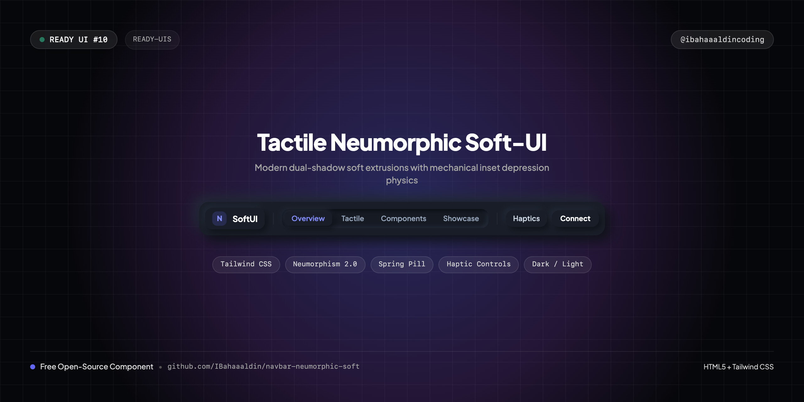
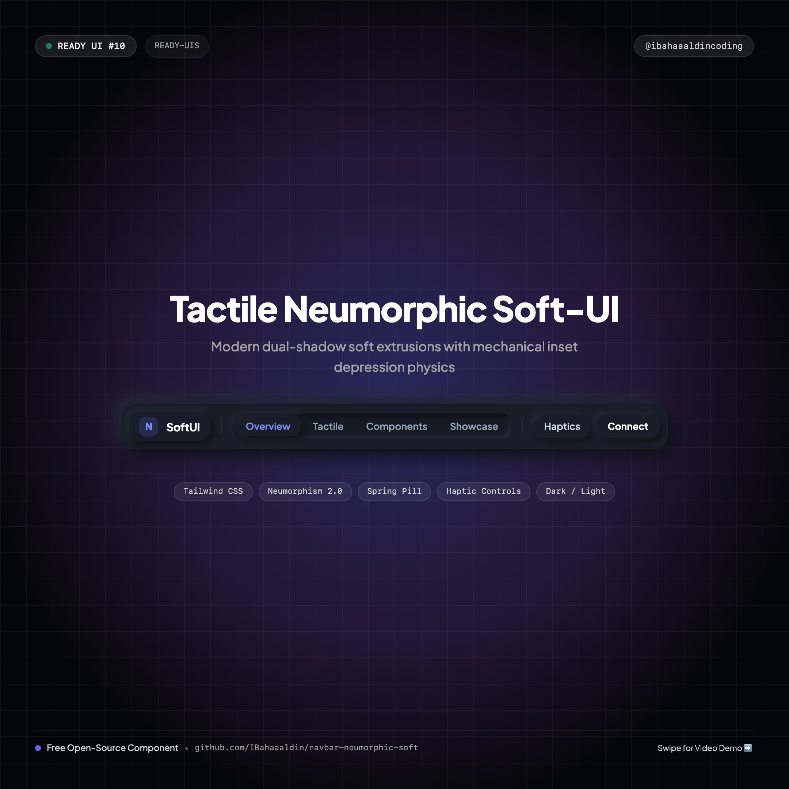
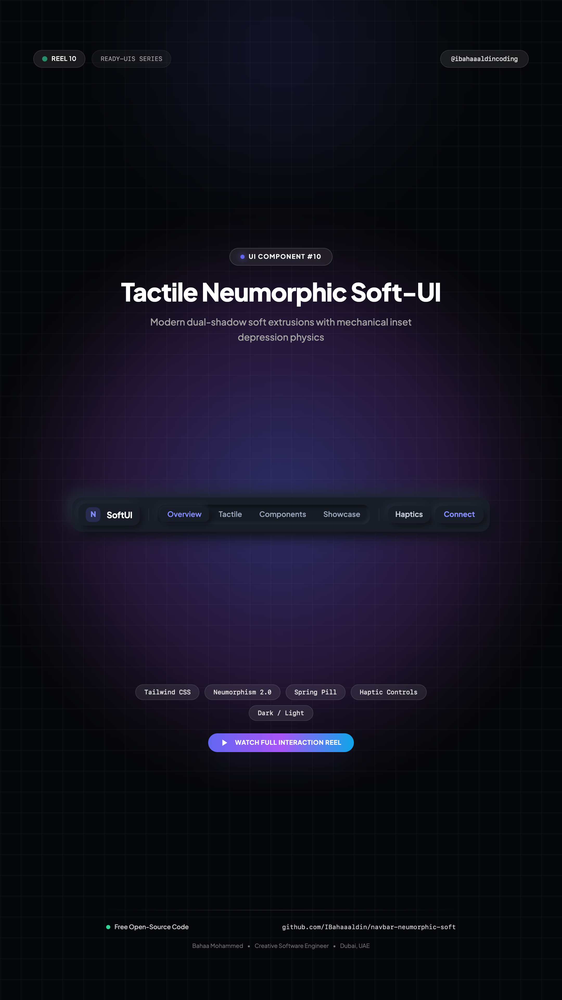

# 🎛️ Tactile Neumorphic Soft-UI Navbar

> Tactile, modern Neumorphic Soft-UI 2.0 navigation bar featuring realistic dual-shadow light extrusions, physical inset depression physics, dynamic spring-loaded active pill, and acoustic feedback.



[](https://IBahaaaldin.github.io/navbar-neumorphic-soft/)
[](https://IBahaaaldin.github.io/navbar-neumorphic-soft/)

---

## 🌐 Visual Previews

| Desktop Showcase (1200x900) | Mobile Showcase (390x844) | Post Cover (1080x1080) | Reel Cover (1080x1920) |
| :---: | :---: | :---: | :---: |
|  |  |  |  |

*(Includes full interaction videos: `video-desktop.mp4` and `video-mobile.mp4`)*

---

## ✨ Features & Micro-Interactions

- **Neumorphism 2.0 Sculpted Surfaces**: Ambient dual soft shadows mapped to directional light coordinates (`9px 9px 20px #... , -9px -9px 20px #...`).
- **Physical Inset Depression**: Interactive buttons and pills physically depress inwards with realistic inset shadows and scaling on mouse down.
- **Spring-Loaded Indicator Pill**: Smooth spring physics glide between tabs (*Overview*, *Tactile*, *Components*, *Showcase*) with dynamically calculated width and position.
- **Tactile Haptics Popover**: Interactive control panel with real-time shadow depth slider, acoustic feedback toggle, and tactile click tester.
- **Web Audio API Feedback**: Zero-asset audio synthesis generating crisp mechanical clicks, taps, and spring pops.
- **One-Click Quick Connect**: Tactile "Connect" button that copies developer email (`bahaam.coding@gmail.com`) with instant checkmark feedback and transition.
- **Instant Dark / Light Mode**: Seamless transition between Deep Obsidian Clay (`#12161f`) and Warm Sculptural Alabaster (`#edf2f7`).
- **Strict Single-Row Typography**: Creator name, roles, and status tags are locked into single lines (`whitespace-nowrap`).
- **Responsive Slide-in Mobile Sheet**: Slides smoothly from the right edge with a dimmed backdrop and tactile controls.
- **Zero Build Step**: Drop-in HTML5, Tailwind CSS CDN, and vanilla JS.

---

## 📁 Repository Structure

```text
├── index.html              # Standalone production navbar component
├── cover.png               # Widescreen cover banner (1280x640)
├── cover-instagram.png     # Square post cover for Instagram (@ibahaaaldincoding) (1080x1080)
├── cover-reel.png          # 9:16 vertical cover for Instagram Reels (1080x1920)
├── screenshot-desktop.png  # Desktop visual preview (1200x900)
├── video-desktop.mp4       # Desktop interaction recording (MP4)
├── screenshot-mobile.png   # Mobile visual preview (390x844)
├── video-mobile.mp4        # Mobile interaction recording (MP4)
├── record.js               # Playwright automation script used to record all 4 assets
├── README.md               # Documentation & setup notes
└── CAPTION.md              # Ready-to-copy Instagram caption for @ibahaaaldincoding
```

---

## 🚀 Quick Start

### 1. View Locally
Simply open `index.html` in your browser:
```bash
open index.html
```

### 2. Re-record Assets
To re-record desktop & mobile screenshots and videos:
```bash
node record.js
```

---

## 👤 Author & Connect

**Bahaa Mohammed**
Creative Developer & Software Engineer
- 📸 **Instagram**: [@ibahaaaldincoding](https://www.instagram.com/ibahaaaldincoding)
- 🐙 **GitHub**: [@IBahaaaldin](https://github.com/IBahaaaldin)
- 💼 **LinkedIn**: [Bahaa Mohammed](https://www.linkedin.com/in/bahaa-mohammed-371259369)
- 📧 **Email**: bahaam.coding@gmail.com

---

## 📄 License

MIT © [Bahaa Mohammed](https://github.com/IBahaaaldin)
